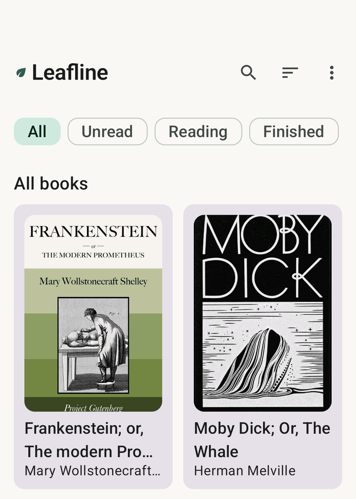

# Leafline

[](https://github.com/jdluu/Leafline/actions/workflows/ci.yml)


A local-first EPUB reader for Android with no accounts, analytics, or telemetry.
Reading, library management, annotations, and statistics all work offline;
OPDS catalog browsing and progress sync are strictly opt-in.

 

## Features

- **Reader:** EPUB 2/3 in paginated or scrolled mode, typography and accessibility presets (including OpenDyslexic and Accessible DfA), adjustable size, line height, margins, five color themes, per-book brightness, edge tap zones, volume-key page turns, footnote previews, and jump history with a return capsule.
- **Notes & search:** Multi-color highlights and notes (filterable by color), offline dictionary lookup, and full-text search (case-sensitive, whole-word, regex, and per-chapter filters).
- **Library & insights:** Grid and list views, multi-select batch actions, collections, series grouping with next-book continuation, reading statuses, 1–5 star ratings, tags, sorting, automatic duplicate merging across re-imports, plus on-device reading stats (7-day activity chart, optional daily goal, and estimated time remaining).
- **Text-to-speech:** On-device playback with adjustable speed, sentence skipping, and a fading sleep timer (5–60 minutes or end of chapter).
- **OPDS & sync (optional):** Browse user-added OPDS 1.x/2.0 catalogs (e.g., Calibre-web, Kavita) with pagination, recent search history, and direct downloads (none bundled). Sync status and progress via encrypted on-device credentials to a self-hosted KOReader-compatible server, Hardcover (OAuth or API token, ISBN-matched with per-book opt-in), or both.
- **Import & export:** Import single or multiple EPUBs via the system picker, or grant non-root folders (such as `Calibre`, `Books`, or `Download/Leafline`) for recursive scanning at any depth with per-folder *Rescan*. Export annotations to Markdown, Obsidian vault ZIP, Readwise CSV, or Anki TSV; back up and restore library metadata, series, positions, and non-secret settings as JSON.

## Install

Requires **Android 8.0 (API 26) or newer**.

[](https://apps.obtainium.imranr.dev/redirect?r=obtainium%3A%2F%2Fadd%2Fhttps%3A%2F%2Fgithub.com%2Fjdluu%2FLeafline)

Install via [Obtainium](https://github.com/ImranR98/Obtainium) for automatic updates, or download an APK from [Releases](https://github.com/jdluu/Leafline/releases). Releases are pre-1.0 (`0.y.z`), so the Room database schema is not yet stable and major bumps may require a reinstall.

## Build

Requires JDK 17 and the Android SDK.

```bash
./gradlew assembleDebug        # debug APK
./gradlew testDebugUnitTest    # unit tests
./gradlew lintDebug            # lint
```

See [AGENTS.md](AGENTS.md) for repository conventions and CI checks.

## License

[MIT](LICENSE)
